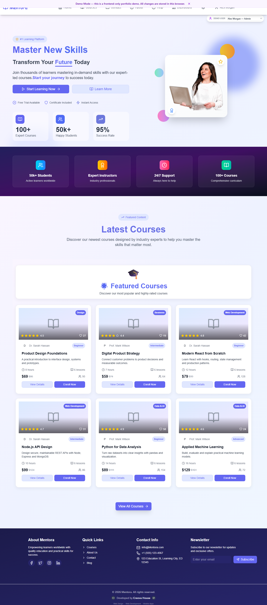
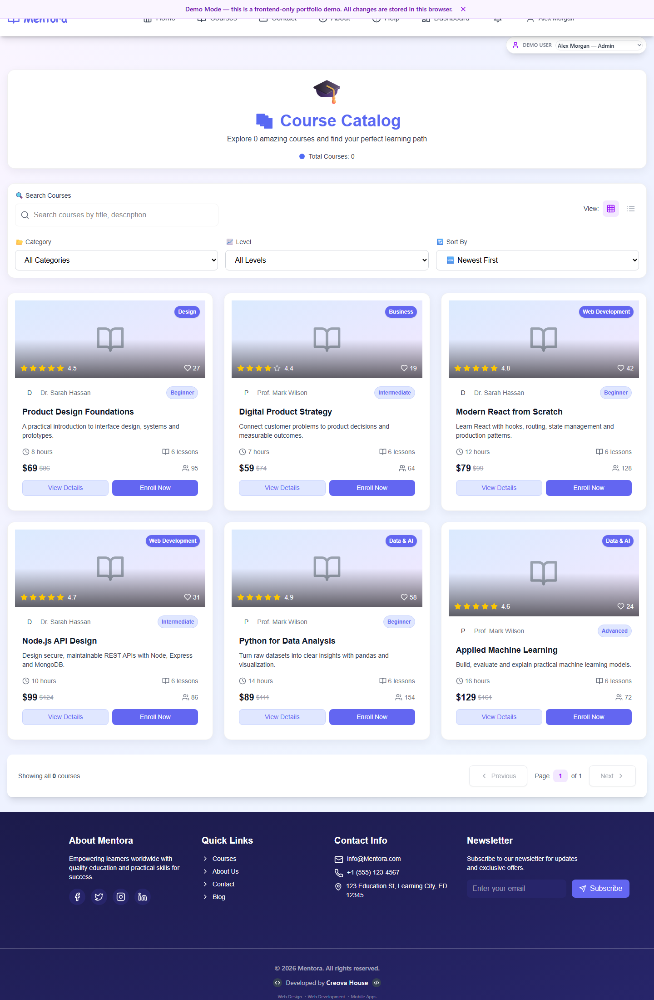
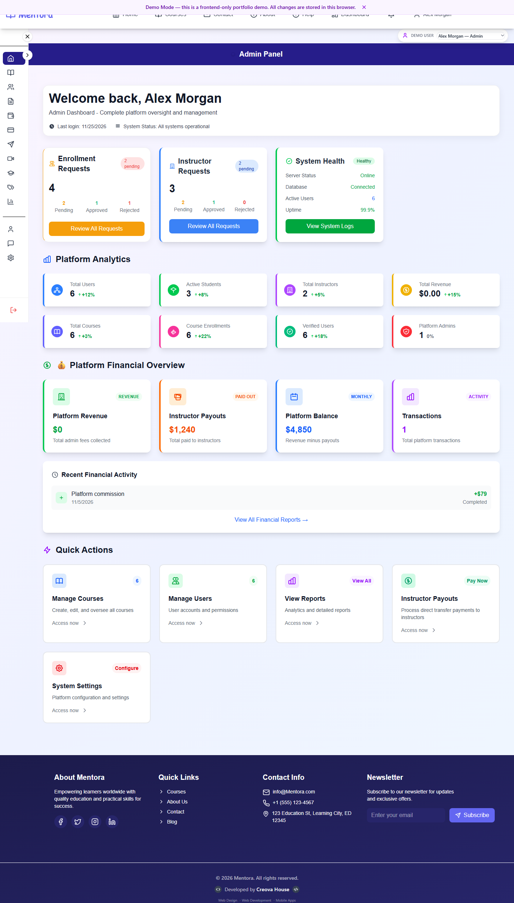
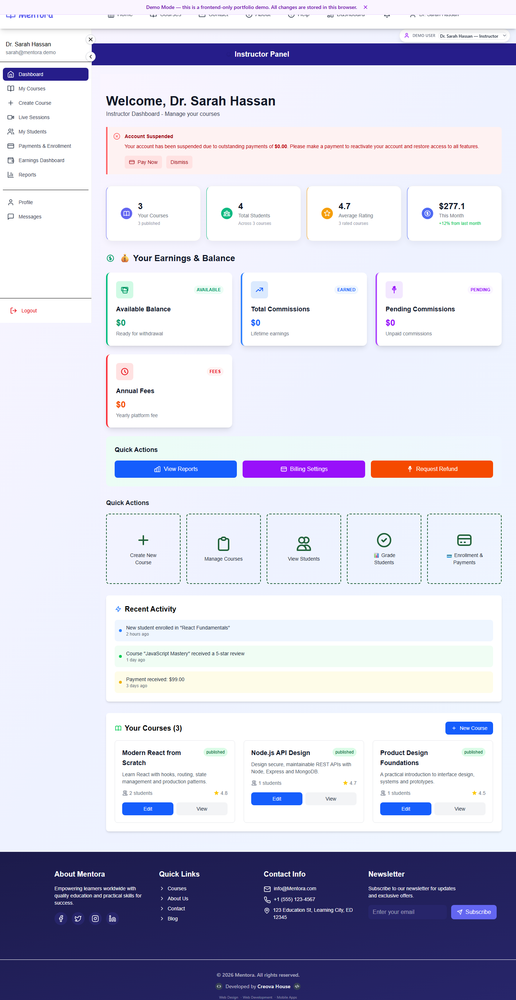
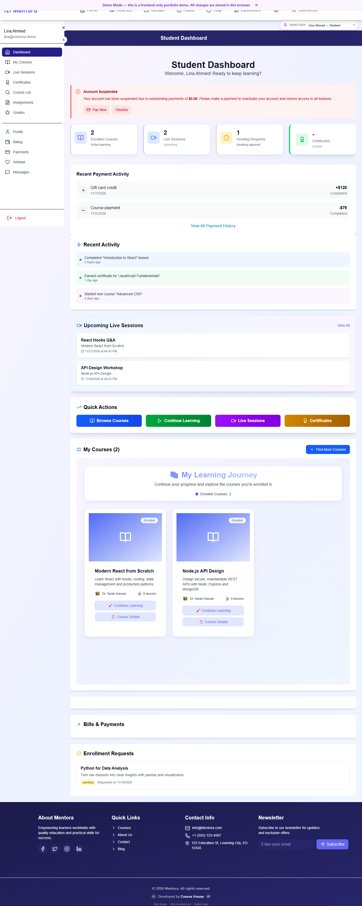
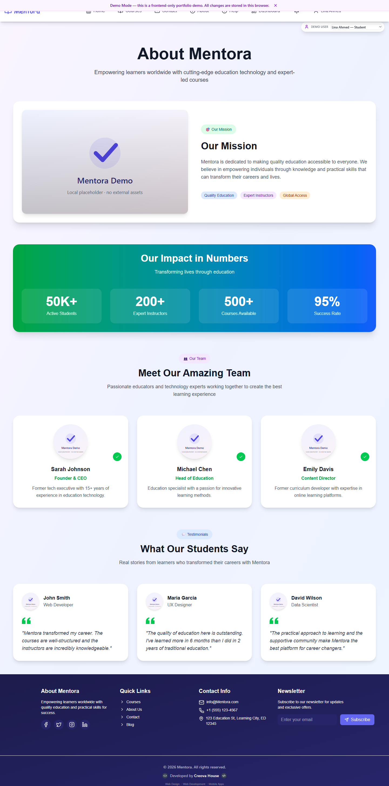

# Mentora Courses — Frontend Demo

A **standalone, static frontend demo** of the Mentora Courses learning platform, prepared for a Creova House portfolio profile.

Everything runs in the browser. There is **no server, no database, no API calls, and no external network requests**. All data lives in `localStorage` and survives a refresh.

> The original `Mentora-Courses` project was left untouched. This repository is a copy of it, renamed and converted into a browser-only demo. The backend, database, and server code have been removed from this demo entirely; no server code is included.

---

## Screenshots

| Public home | Course catalog |
| --- | --- |
|  |  |

| Admin dashboard | Instructor dashboard |
| --- | --- |
|  |  |

| Student dashboard | About page |
| --- | --- |
|  |  |

---

## Quick start

```bash
cd client
npm install
npm run dev
```

Open the URL printed by Vite (usually `http://localhost:5173`). No environment variables, database, or backend service are needed.

### Production build

```bash
cd client
npm run build
npm run lint
```

The optimized static site is written to `client/dist/`.

### Serving the static build

```bash
cd client
npm run preview
```

`npm run preview` serves `dist/` at `http://localhost:4173` and includes the SPA fallback needed for direct links such as `/courses/course-1`, `/admin/refunds`, or `/student/dashboard`.

Any static host works too (Netlify, Vercel, GitHub Pages with an SPA rewrite, Nginx, etc.). Configure the host to serve `index.html` for unknown paths so React Router can handle them.

---

## Demo behaviour

- On first load, demo data is seeded into `localStorage` from `client/src/data/demoSeed.js`.
- The app **auto-logs in as the seeded admin** (`Alex Morgan`) so every authenticated area is immediately reachable. Role guards still exist; switch users to enter the instructor or student areas.
- Every storage operation is asynchronous and simulated with a **200–300 ms delay**, using the same `{ success, message, data, meta? }` response shape the UI expects without any network requests.
- `/api/...` requests — including ones made with raw `fetch()` — are intercepted in the browser and answered by a local route table. Creates, edits, and deletes are written straight to `localStorage`, and results are surfaced with toast notifications.
- A dismissible **Demo Mode** banner and a fixed **Demo Mode** badge make it clear this is a frontend-only showcase.
- A persistent **Demo user** dropdown at the top right (below the nav bar, under the Demo Mode badge) switches between the seeded admin, two instructors, and three students. It updates the local session, clears cached RTK Query data, and opens the matching role dashboard; the choice survives a reload.
- **Reset Demo Data** (top-right, next to the badge) restores the original seed data and admin session and returns to `/admin`.
- `Login`, `Register`, `Forgot Password`, and `Instructor Request` still work as interactive demos and write local session/user state where relevant.
- Payments, certificate downloads, Zoom links, and mail links are simulated locally — no third-party SDK is contacted. External images were replaced with a bundled `/demo-placeholder.svg`.

### Demo credentials

| Purpose | Email | Password |
| --- | --- | --- |
| Admin (auto-login) | `admin@mentora.demo` | `demo1234` |
| Instructors | `sarah@mentora.demo`, `mark@mentora.demo` | `demo1234` |
| Students | `lina@mentora.demo`, `omar@mentora.demo`, `nora@mentora.demo` | `demo1234` |

All seeded accounts use `demo1234`. These are public demo-only credentials; do not reuse them elsewhere. You can also use the **Demo user** dropdown instead of logging in.

---

## Routes and features

| Route | What it demonstrates |
| --- | --- |
| `/` | Public marketing home with hero, stats, and course CTAs |
| `/courses` | Searchable, filterable, paginated course catalog |
| `/courses/:courseId` | Course detail, lessons, ratings, enrollment |
| `/courses/:courseId/learn`, `/lessons/:lessonId/edit` | Lesson viewer and editor |
| `/courses/:courseId/enroll`, `/payment/:courseId` | Demo enrollment and simulated checkout |
| `/payment/success`, `/payment/cancel` | Checkout result screens |
| `/about`, `/contact`, `/help`, `/terms-and-conditions` | Static public pages |
| `/instructor/:id` | Public instructor profile |
| `/login`, `/register`, `/forgot-password`, `/instructor-register` | Auth and instructor-request demos |
| `/admin` | Admin dashboard with KPIs and quick actions |
| `/admin/instructors`, `/admin/instructor-requests`, `/admin/manage-users` | People and request management |
| `/admin/manage-courses`, `/admin/manage-categories`, `/admin/enrollment-requests` | Course catalogue and enrollment workflow |
| `/admin/live-sessions`, `/admin/messages`, `/admin/notifications` | Sessions, messaging, notifications |
| `/admin/reports`, `/admin/payments`, `/admin/instructor-payouts`, `/admin/refunds` | Reporting, payments, payouts, refunds |
| `/admin/payment-settings`, `/admin/settings`, `/admin/system-config`, `/admin/system-health` | Platform configuration |
| `/instructor` | Instructor dashboard |
| `/instructor/courses`, `/instructor/courses/new`, `/instructor/courses/edit/:id` | Instructor course CRUD |
| `/instructor/live-sessions`, `/instructor/students`, `/instructor/grading`, `/instructor/reports` | Teaching workflows |
| `/instructor/payments`, `/instructor/refunds`, `/instructor/messages`, `/instructor/notifications` | Instructor earnings and communications |
| `/student/dashboard`, `/student/courses`, `/student/certificates` | Student learning overview |
| `/student/live-sessions`, `/student/assignments`, `/student/grades`, `/student/schedule` | Student learning workflows |
| `/student/messages`, `/student/notifications`, `/student/wishlist`, `/student/refunds`, `/student/payments` | Student account pages |
| `/profile`, `/billing`, `/grading/:courseId/:testId`, `/my-courses`, `/certificates` | Shared authenticated pages |
| `*` | Not found page |

All areas are reachable in demo mode by using the **Demo user** switcher or by logging in as a seeded account.

---

## How it is built

### Tech stack

- React 18 + Vite 6
- Redux Toolkit / RTK Query (a localStorage-backed `baseQuery`; no HTTP client remains)
- React Router 6
- Tailwind CSS v4
- Lucide React icons
- date-fns, DOMPurify, jwt-decode
- React Toastify

### Key files

```text
client/
├── public/
│   ├── demo-placeholder.svg         # bundled image used instead of external assets
│   └── vite.svg
├── src/
│   ├── data/
│   │   └── demoSeed.js              # demo users, courses, lessons, payments, etc.
│   ├── services/
│   │   └── demoStorage.js           # seeded localStorage collections and session helpers
│   ├── store/api/
│   │   ├── demoRouter.js            # localStorage baseQuery, fetch shim, delayed envelopes
│   │   ├── demoHandlers.js          # route table mirroring the original API URLs
│   │   ├── demoUtils.js             # envelopes, pagination, enrichment, role checks
│   │   └── apiSlice.js              # original RTK Query core, now local
│   ├── components/demo/
│   │   └── DemoChrome.jsx           # banner, Demo Mode badge, user switcher, reset button
│   ├── store/slices/
│   │   └── authSlice.js             # admin auto-login and demo user switching
│   ├── main.jsx                     # global fetch/window.open demo shims
│   ├── App.jsx                      # router, demo chrome, error boundary
│   └── AppRoutes.jsx                # original route tree
└── package.json                     # dev/build/lint/preview only; no test harness
```

`demoRouter.js` resolves `/api/...` requests against the route table in `demoHandlers.js`, waits 200–300 ms, and returns `{ success, message, data, meta? }`. Errors use `{ success: false, message, data: null, status }`.

### localStorage keys

| Key | Contents |
| --- | --- |
| `mentoraDemo.users` | Seeded accounts |
| `mentoraDemo.categories`, `mentoraDemo.courses`, `mentoraDemo.lessons` | Course catalogue |
| `mentoraDemo.enrollments`, `mentoraDemo.progress` | Enrollment and learner progress |
| `mentoraDemo.wishlist`, `mentoraDemo.cart` | Saved courses and cart |
| `mentoraDemo.courseInteractions`, `mentoraDemo.liveSessions` | Course interactions and sessions |
| `mentoraDemo.enrollmentRequests`, `mentoraDemo.instructorRequests` | Workflow requests and notes |
| `mentoraDemo.notifications`, `mentoraDemo.messages` | In-app communication |
| `mentoraDemo.grades`, `mentoraDemo.certificates` | Assessment results |
| `mentoraDemo.payments`, `mentoraDemo.billingAccounts`, `mentoraDemo.billingTransactions` | Billing data |
| `mentoraDemo.giftCards`, `mentoraDemo.payoutRequests`, `mentoraDemo.refunds` | Financial workflows |
| `mentoraDemo.levels`, `mentoraDemo.adminSettings` | Platform configuration |
| `mentoraDemo.session`, `token`, `persist` | Current demo session |
| `mentoraDemo.bannerDismissed` | Whether the demo banner was closed |
| `mentoraDemo.version` | Seed version marker |

Clear these keys (or use **Reset Demo Data**) to start over.

---

## Verification completed

- [x] `npm run lint` — 0 errors (only 13 pre-existing `react-hooks/exhaustive-deps` warnings).
- [x] `npm run build` — successful static build (only a non-blocking chunk-size warning).
- [x] Served `client/dist/` with `npm run preview` and swept public, auth, admin, instructor, student, and 404 routes with no console errors.
- [x] Verified wishlist create/read/delete, refund aliases, note-edit aliases, admin settings `paymentSettings`, and certificate `downloadUrl` responses.
- [x] Refreshed the browser after a wishlist write and confirmed `localStorage` persistence.
- [x] Used the **Demo user** dropdown to switch admin → instructor → student → admin, confirmed the matching dashboard and persisted session after reload.
- [x] Dismissed the demo banner and confirmed it stays hidden after reload; used **Reset Demo Data** and confirmed the seed state and admin session return.
- [x] Checked the browser network log: only local static `document`, `script`, `stylesheet`, and `image` requests; no third-party requests; no console errors.
- [x] Captured the six screenshots above from the built static site.

---

## Demo-only security note

This is a portfolio demo, not a production application. Passwords are stored in plain text in `localStorage`, and authentication is simulated. Do not use real credentials, and do not deploy this build where sensitive data is expected. The original MERN project should be used for any real authentication or persistence needs.

---

## Original project

The original full-stack MERN project remains untouched in the sibling `Mentora-Courses` folder. It is not required to run this demo.
